  

### Hi there 👋

I'm a FiveM learning developer interested in QBCore and QBox. I enjoy casual development in my free time.

- 🔭 I’m currently working on improving my skills in Lua programming for FiveM development.
- 🌱 I’m currently learning more about QBCore and QBox frameworks.
- 💬 Ask me about FiveM development or anything related to Lua programming!
- ⚡ Fun fact: I'm passionate about gaming and enjoy exploring new game mechanics in my spare time.

I'm from Finland 🇫🇮 and born in 1997. I'm also fond of fishing as a hobby.

I study and practice coding by leveraging AI, using modern technology to my advantage.

---

<h3 align="center">🧰 Languages and Tools:</h3>

  
  

